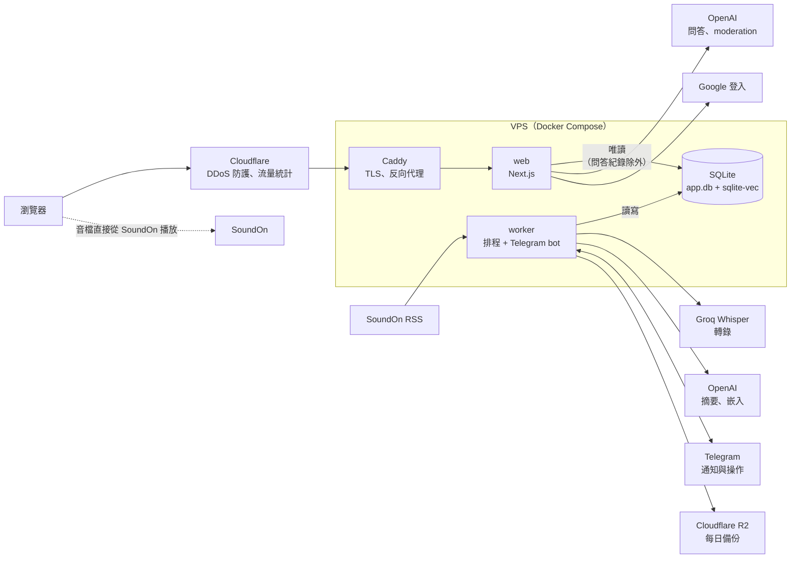
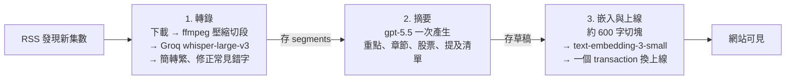
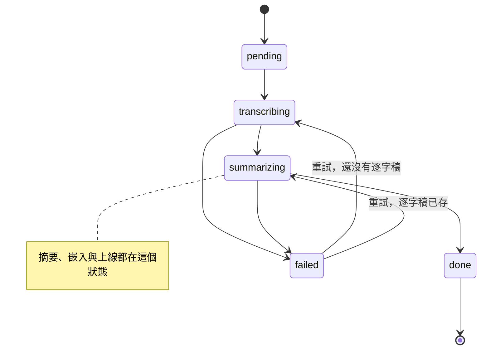
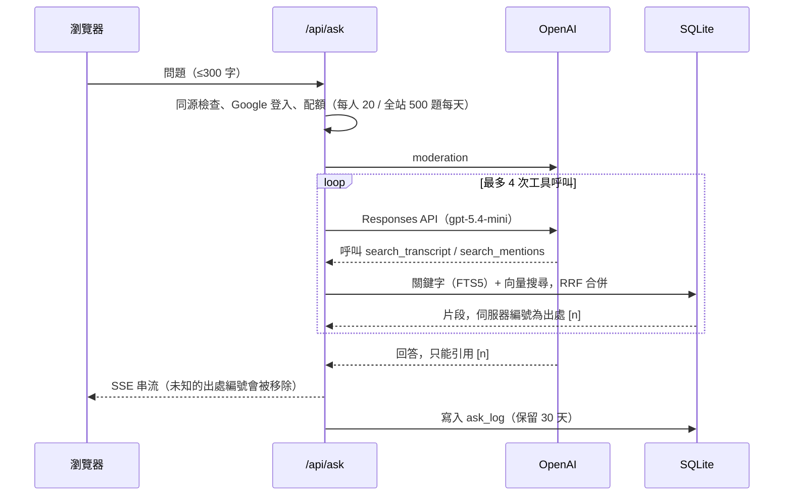
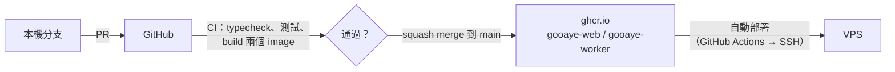

# 股癌搜尋

https://gooaye-notes.com

Podcast《股癌 Gooaye》的非官方筆記網站：

- **每集重點**：一句話摘要、章節、提到的股票，以及餐廳、運動、書影音等提及清單，每一項都附時間點。
- **逐字稿**：可以搜尋，點時間點會從那裡開始播放。
- **問答**：跨集數提問，回答會附上出處（第幾集、幾分幾秒），登入 Google 後每天可以問 20 題。

網站內容由 AI 根據逐字稿自動產生，可能有誤，請以原節目為準；不構成投資建議。本站與《股癌》節目及謝孟恭無關。

## 系統架構

一個 repo、兩個程式、一個 SQLite 檔：**worker** 負責把新集數變成資料，**web**（Next.js）負責顯示和問答。兩者不互相呼叫，只透過同一個資料庫檔案交換資料。



| 元件 | 位置 | 做什麼 |
|---|---|---|
| web | `src/` | 集數列表、每集頁面（重點 + 逐字稿 + 播放器）、`/ask` 問答、`/api/ask`（SSE 串流） |
| worker | `worker/` | 輪詢 RSS、處理新集數、每晚清理與備份、Telegram bot |
| 資料庫 | `src/lib/db.ts` | SQLite（better-sqlite3）+ sqlite-vec；migration 只由 worker 執行 |
| 部署 | `deploy/` | compose、Caddy 站台設定、部署腳本；共用 Caddy 在 `deploy/proxy/` |
| 測試 | `tests/` | vitest，記憶體內 SQLite，所有外部 API 都用 stub |

## 新集數的處理流程

RSS 只在發佈日（週三、週六）10:00–23:30（台北時間）每 30 分鐘檢查一次。發現新集數後分三步處理，**每一步完成就存檔**：失敗重試時從失敗的那一步接著做，已經付過錢的步驟不會重跑。





- 每集成本約 US$0.40，記在 `episodes.cost_usd`，Telegram 通知會附上。
- 重新處理已上線的集數時，舊版本會一直顯示到新版本上線；重跑失敗就保留舊版。
- 所有工作（排程、Telegram 指令）都排進同一個佇列，一次只跑一個，避免重複處理同一集。
- 失敗、排程錯誤、備份失敗、發佈日 23:30 還沒有新集數，都會發 Telegram 通知；worker 自己掛掉時由外部服務通知（UptimeRobot 檢查網站、Healthchecks.io 收 worker 心跳與每晚備份）。`/status`、`/retry N`、`/resummarize N`、`/retranscribe N` 可以從手機操作，`/stats` 看問答統計，每週一 09:00 會收到上週摘要。

## 問答流程



- 使用者的問題只放在 user 訊息的 `<question>` 裡，不會拼進 system prompt；逐字稿也視為不可信內容，工具結果包在 `<transcript>` / `<mention>` 標籤裡並跳脫角括號。
- 回答只轉述節目說了什麼，不做多空判斷，也不給投資建議。

## 資料庫

| 資料表 | 內容 |
|---|---|
| `episodes` | 集數、狀態、逐字稿 segments、摘要、失敗的步驟、成本 |
| `chunks` / `chunks_fts` / `chunks_vec` | 逐字稿切塊，以及它的全文索引（FTS5 trigram）和向量索引（1536 維） |
| `mentions` | 提到的股票、餐廳、書影音等，附原話和時間點 |
| `ask_usage` / `ask_log` | 問答配額，以及問答紀錄：問題、回答、結果（有出處／沒出處／被擋／失敗）、耗時、成本，30 天後刪除 |
| `ask_daily` | 每天的問答統計數字，永久保留 |

## 部署



- 一台 Vultr VPS（1 vCPU / 2 GB）。web 和 worker 在 `/opt/gooaye`，前面是所有 app 共用的 Caddy（`/opt/proxy`，唯一對外開 80/443 的容器）。
- 所有流量都先經過 Cloudflare（DNS 開橘色雲朵，SSL 設 Full (strict)）。Vultr 防火牆只讓 Cloudflare 連 80/443，直接連 VPS 的 IP 會逾時。加入新 app 的方式見 [`deploy/proxy/README.md`](deploy/proxy/README.md)。
- 合併到 main 就自動部署：先跑資料庫 migration、更新網站，worker 等手上的工作做完才更新（最多等 60 分鐘），結果發到 Telegram。VPS 不 build，只拉 CI 做好的 image。
- 回退：GitHub 的 Actions → **deploy** → Run workflow，填入要回到的 commit sha；或在本機跑 `deploy/deploy.sh <sha>`。
- 資料庫每晚 gzip 備份到 Cloudflare R2，保留 30 天；上傳前檢查完整性。還原演練與步驟見 [`deploy/restore.md`](deploy/restore.md)。

## 本機開發

需要 Node 22 以上。

```bash
npm install
npm run dev:seed   # 用範例資料建立 data/dev.db，不需要任何 API key
npm run dev        # http://localhost:3005
npm run check      # typecheck + 測試 + build
```

要跑真的轉錄、整理重點或問答，把 `.env.example` 複製成 `.env.local` 並填入 key（只用開發專用的 key），再用 `npm run worker -- ingest <集數>` 處理單集。也可以用 `npm run db:pull` 拉一份正式資料庫的快照（不含問答紀錄），再 `DB_PATH=data/prod.db npm run dev`。

main 只接受 PR：開分支 → `npm run check` → 手動測試 → PR，CI 通過後 squash merge。指令、環境設定與開發規則在 [CLAUDE.md](CLAUDE.md)。

舊版（Express + Elasticsearch + Python）保留在 tag [`v1-es-final`](https://github.com/tommy3713/podcast-search/tree/v1-es-final)。
