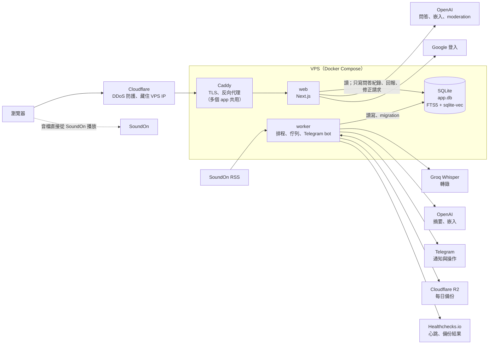
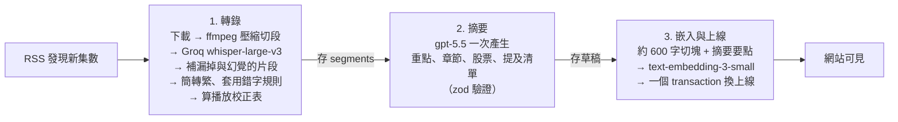
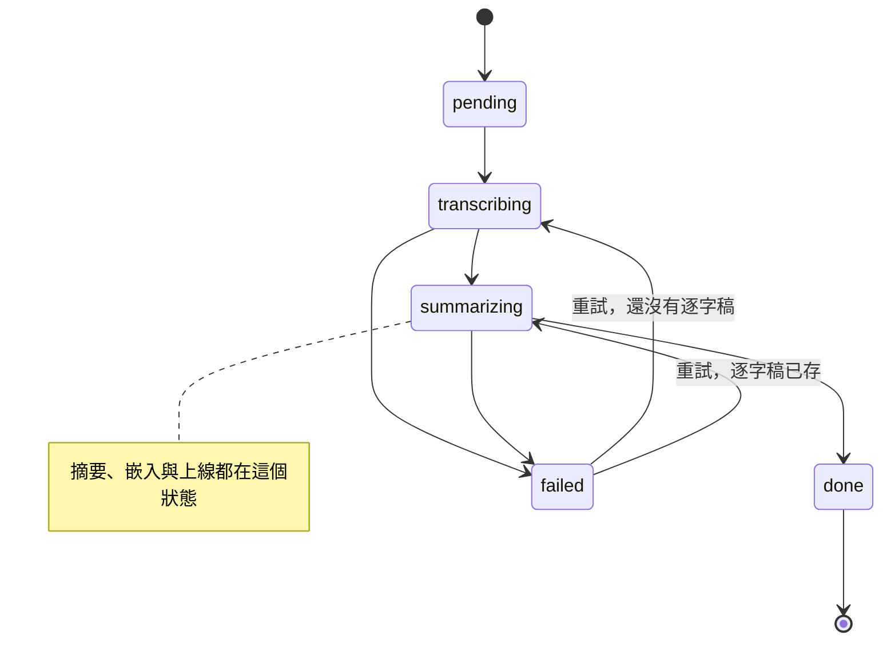
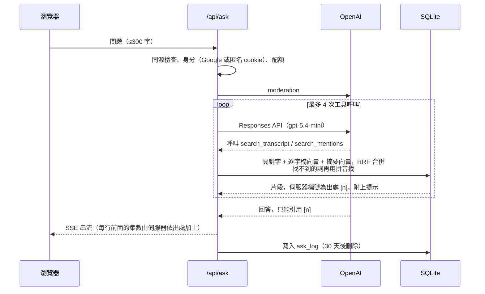
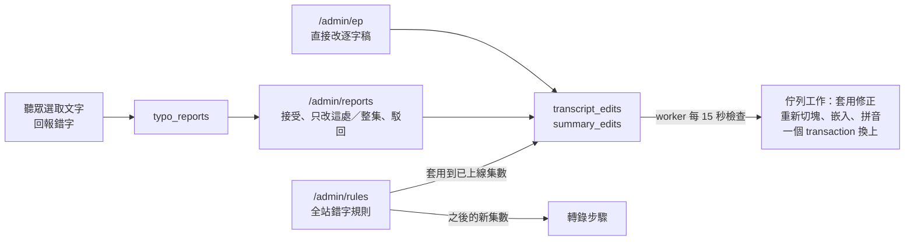
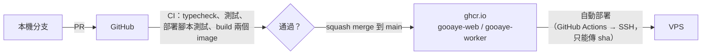

# 股癌搜尋

https://gooaye-notes.com

Podcast《股癌 Gooaye》的非官方筆記網站，從 EP1 到最新一集都有：

- **每集重點**：一句話摘要、章節、提到的股票，以及美食、運動、書影音等提及清單，每一項都附時間點；集數頁下方有上一集／下一集與內容相近的集數。
- **逐字稿**：可以在集內搜尋，點時間點就從那裡開始播放；看到錯字可以選取文字回報。
- **全站搜尋**（`/search`）：所有集數的逐字稿和重點，不經過 AI、不計次數。
- **問答**（`/ask`）：跨集數提問，回答附上出處（第幾集、幾分幾秒）。免登入每天 5 題，登入 Google 後每天 20 題；找不到想要的可以按「擴大搜尋」再找一次，也可以為回答評分。
- **主題**（`/topics`）：個股、業配、運動、電玩、旅遊、書影音、美食、科技產品、家庭、節日，各自整理成「哪幾集提過、怎麼說的」。
- **歷史上的今天**：首頁列出往年同一天前後的那一集。

網站內容由 AI 根據逐字稿自動產生，可能有誤，請以原節目為準；不構成投資建議。本站與《股癌》節目及謝孟恭無關。

## 系統架構

一個 repo、兩個程式、一個 SQLite 檔：**worker** 把新集數變成資料，**web**（Next.js）負責顯示、搜尋和問答。兩者不互相呼叫，只透過同一個資料庫檔案交換資料。web 只寫「使用者送來的東西」（問答紀錄、錯字回報、意見回饋、管理員的修正），需要重算索引的修正由 worker 撿起來處理。



| 元件 | 位置 | 做什麼 |
|---|---|---|
| web | `src/app`、`src/components` | 集數列表、集數頁（重點 + 逐字稿 + 播放器）、`/search`、`/ask` 與 `/api/ask`（SSE 串流）、主題頁、`/admin` |
| 共用邏輯 | `src/lib` | 資料庫、問答 agent（`ask/`）、摘要格式、主題與個股索引、播放校正、成本計算，web 和 worker 共用 |
| worker | `worker/` | 輪詢 RSS、三步處理流程、補舊集數、套用修正、每晚清理與備份、監控、Telegram bot |
| 部署 | `deploy/` | compose、Caddy 站台設定、部署與回退腳本；共用 Caddy 在 `deploy/proxy/` |
| 測試 | `tests/`、`evals/` | vitest（記憶體內 SQLite，外部 API 全部 stub）；問答品質的黃金題組 |

技術：TypeScript、Next.js 16（App Router）、React、better-sqlite3、SQLite FTS5（trigram）、sqlite-vec、OpenAI Responses API、Groq Whisper、ffmpeg、OpenCC、Docker、GitHub Actions、Caddy、Cloudflare。

## 新集數的處理流程

RSS 只在發佈日（週三、週六）10:00–23:30（台北時間）每 30 分鐘檢查一次。發現新集數後分三步處理，**每一步完成就存檔**：失敗重試時從失敗的那一步接著做，已經付過錢的步驟不會重跑。





- **Whisper 的兩種失敗**：有些 30 秒的窗口會整段漏掉，或回一句編出來的話（字幕組署名、影片片尾、把提示詞倒背回來）。處理前 715 集裡有 695 集有這種片段。現在 12 秒以上的空白和可疑片段（已知的幻覺句、大半是提示詞、太長卻字太少）會單獨重轉，先帶提示詞，不行再不帶。舊集數由 `/repair` 一次性補過。
- **錯字修正**：OpenCC `s2tw` 轉繁體後修正它轉錯的字，再套用 `/admin/rules` 裡的規則（人名、股票名常被聽錯）。Whisper 的提示詞也在 `/admin/whisper` 編輯、有版本紀錄，每集記下用的是哪一版。
- **成本**：每集約 US$0.36，記在 `episodes.cost_usd`，Telegram 通知會附上。全部 715 集處理下來約 US$260。
- **重跑不影響線上**：重新處理已上線的集數時，舊版本會一直顯示到新版本上線；重跑失敗就保留舊版。
- **一個佇列**：所有工作（排程、Telegram 指令、補舊集數、套用修正）都排進同一個佇列，一次只跑一個，新集數排在最前面。
- **補舊集數**：RSS 輪詢只加比最新一集更新的集數，更早的用 `/backfill N` 補：先列出要補哪幾集和估計成本，按確認才開始，每集之間停兩分鐘讓其他工作插隊，進度存在資料庫裡，worker 重啟會接著做。EP1–699 都是這樣補進來的。

## 問答流程



**檢索**（`src/lib/ask/search.ts`）是混合搜尋，三種排序用 Reciprocal Rank Fusion 合併：

1. **關鍵字**：FTS5 trigram（中文不用斷詞；少於 3 個字改用 `LIKE`）。
2. **逐字稿向量**：每個約 600 字的切塊，sqlite-vec 做 KNN。
3. **摘要向量**：摘要的章節與重點也嵌入，找到最近的要點後換成那一章裡最接近的逐字稿切塊。聽眾問問題的用語比較像寫出來的摘要，不像口語的逐字稿。模型最後只看得到、也只能引用逐字稿切塊。

另外，3 個中文字以上的詞如果任何逐字稿都沒有，會改用無聲調拼音再找一次（`chunks_pinyin`），因為轉錄常把名字寫成同音的其他字（椒鹽肥腸 → 交言肥腸）。兩個工具都能用集數或日期範圍篩選，篩選在 SQL 查詢裡做，所以範圍內的舊集數不會被筆數上限擠掉。

**伺服器替模型做的事**（都是從錯誤答案裡學到的）：

- 出處由伺服器編號，每段文字開頭寫上自己的 `[n]` 和集數；每一行回答開頭的集數也是從引用算出來，不讓模型自己寫（讓它寫的話約 4% 會標錯集）。
- 搜尋撞到筆數上限、或問的詞在任何一集都沒出現時，工具結果會附上提示，避免模型把不相干的片段當成答案（問 Rivian，答了 Tesla Roadster）。
- 片段裡有交易用語（做多、減碼、停損…）時，提醒模型只能用「他說」加原話引號轉述，不能改寫成自己的建議。

**問答頁的其他功能**：

- **不是你要找的？**：列出搜尋找到、但回答沒引用的片段。
- **擴大搜尋**：同一題免費再問一次，6 次搜尋、45 秒、不限日期，並告訴模型「聽眾記得的用詞可能不對」。用過的搜尋詞從紀錄讀，不從瀏覽器拿。
- **評分**：😀／🙁，🙁 可以選原因、寫備註；管理員在 `/admin/asks` 看，Telegram 每週摘要也會列出。
- **範例回答**：預先問好存成 `showcase.json`，點了只是顯示，不花任何人的額度。
- **免登入**：瀏覽器拿到一個隨機 token 的 HttpOnly cookie，每天用 HMAC 換成當天的 id，所以不同天的問題連不起來，IP 也不記。每個瀏覽器每天 5 題、每個網路 10 題、全站匿名 100 題；登入每人 20 題、全站 500 題。

**Prompt 安全**：使用者的問題只放在 user 訊息的 `<question>` 裡，不拼進 system prompt；逐字稿也視為不可信內容（節目會唸聽眾來信），工具結果包在 `<transcript>` / `<mention>` 標籤裡並跳脫角括號。回答只轉述節目說了什麼，不做多空判斷、不給投資建議、不附網址。

## 人工修正

AI 轉錄一定有錯，所以有一條從聽眾到逐字稿的修正流程：



- web 只新增修正紀錄，重新切塊與嵌入由 worker 在佇列裡做，所以修正不會跟同一集的重跑搶著寫。
- 修正從不刪除，復原就是再送一筆改回去；之後重新轉錄或重新摘要時，已套用的修正會自動放回新版本。
- 意見回饋（問題回報、功能許願）從標頭的按鈕送出，管理員在 `/admin/feedback` 看、用自己的 Gmail 回覆，網站不寄信。

## 主題與個股頁

`/stocks`、`/stock/<slug>`、`/sponsors`、`/topic/...` 沒有自己的資料表，都是從摘要產生的 `mentions` 和 `summary_json` 即時算出來的索引，放在記憶體裡，直到上線集數有變才重建。

- 同一家公司在不同集的摘要裡寫法不一（台積電寫成 `2330`、`TSM`、`2330.TW/TSM`；Google 有 8 種名字），所以用代號正規化和別名表合併。業配品牌、主題項目也一樣。
- 個股頁只列「哪幾集提過、怎麼說的」，排序依市場和代號、不依提到次數，也不標看多看空，避免讀起來像推薦清單。
- 節日沒有出現在摘要裡，是直接在逐字稿裡找的。
- 「內容相近的集數」用每集摘要向量的平均，不用額外付費。

## 播放時間校正

SoundOn 的 MP3 是 VBR，瀏覽器跳轉時用 Xing 表推算位置，結果點了時間點，逐字稿會跟聲音差到 ±19 秒。worker 轉錄時順便讀一次整個音檔，算出每 0.1% 位置實際落在哪（`seek_json`，每集約 5.5 KB）；播放器依瀏覽器套用對應的模型（Chromium 找表上的前一格，macOS Safari 在兩格之間內插），實測誤差在 0.2 秒內。沒量過的瀏覽器（Firefox、iOS）不做校正，因為猜錯模型只會讓誤差更大。

## 資料庫

| 資料表 | 內容 |
|---|---|
| `episodes` | 集數、狀態、逐字稿 segments、摘要（含草稿）、失敗的步驟、成本、來源（rss／backfill）、播放校正表 |
| `chunks` / `chunks_fts` / `chunks_vec` / `chunks_pinyin` | 逐字稿切塊，以及全文索引（FTS5 trigram）、向量索引（1536 維）、拼音索引 |
| `summary_points` / `summary_points_vec` | 摘要的章節與重點，只用來幫逐字稿切塊排序 |
| `mentions` | 提到的股票、美食、書影音等，附原話和時間點 |
| `ask_usage` / `ask_log` / `ask_retries` | 問答配額；問答紀錄（問題、回答、引用的片段、搜尋過程、耗時、成本、評分），30 天後刪除 |
| `ask_daily` | 每天的問答統計數字，永久保留 |
| `transcript_edits` / `summary_edits` | 管理員的修正，worker 套用 |
| `text_fixes` / `whisper_prompts` | 全站錯字規則；Whisper 提示詞的各個版本 |
| `typo_reports` / `feedback` | 聽眾的錯字回報；意見回饋 |
| `worker_state` | worker 重啟後要接著做的事（補集數進度、每週摘要） |

Migration 只由 worker 執行，而且必須跟上一版相容（部署時舊 worker 可能還在新 schema 上跑一小時），所以只加欄位、加表，不改名、不刪除。

## 隱私

- 問答紀錄 30 天後真的刪掉：刪除後跑 `VACUUM`、每晚截斷 WAL，因為 `DELETE` 會把文字留在空頁裡；備份與 `db:pull` 的快照都不含問答紀錄。`tests/ask-log-privacy.test.ts` 直接檢查資料庫原始檔案。
- 登入只保留 Google 的帳號 id 和名字，不存 email；回報者的帳號 30 天後清掉，意見回饋的帳號和 email 180 天後清掉，內容保留。
- 管理頁只顯示帳號 id 的雜湊，不顯示 id 本身。

## 監控

- worker 每次失敗、排程錯誤、備份失敗、發佈日 23:30 還沒有新集數，都會發 Telegram 通知。
- worker 自己掛掉時由外部服務通知：Healthchecks.io 收 30 分鐘一次的心跳（有工作卡超過 2 小時也會停），以及每晚備份的結果；UptimeRobot 從外面檢查首頁。
- 每晚也檢查剩餘磁碟和上線集數有沒有變少。
- Telegram 指令：`/status`、`/poll`、`/retry N`、`/resummarize N`、`/retranscribe N`、`/backfill [N|stop]`、`/repair [N|stop]`、`/stats [天數]`、`/questions`（點編號看完整回答與搜尋過程）；每週一 09:00 收到上週的問答摘要。

## 部署



- 一台 Vultr VPS（1 vCPU / 2 GB）。web 和 worker 在 `/opt/gooaye`，前面是所有 app 共用的 Caddy（`/opt/proxy`，唯一對外開 80/443 的容器）。
- 所有流量都先經過 Cloudflare（DNS 開橘色雲朵，SSL 設 Full (strict)）。Vultr 防火牆（在 VM 外面，Docker 繞不過去）只讓 Cloudflare 連 80/443，直接連 VPS 的 IP 會逾時。加入新 app 的方式見 [`deploy/proxy/README.md`](deploy/proxy/README.md)。
- 合併到 main 就自動部署：部署用的 SSH key 被 `authorized_keys` 限定只能執行部署腳本，唯一的輸入是 commit sha，且必須在 main 上。部署先跑資料庫 migration、更新網站，在 VPS 上經 Caddy 檢查首頁（不經過 Cloudflare；要看到集數列表，只有標題不算），失敗就自動退回原本的版本；worker 等佇列空了、也不在排程整點附近才更新（最多等 60 分鐘），結果發到 Telegram。VPS 不 build，只拉 CI 做好的 image。
- 回退：GitHub 的 Actions → **deploy** → Run workflow，填入要回到的 commit sha；或在本機跑 `deploy/deploy.sh <sha>`。
- 資料庫每晚串流 gzip 備份到 Cloudflare R2，保留 30 天；上傳前檢查完整性。還原演練與步驟見 [`deploy/restore.md`](deploy/restore.md)。

## 測試與問答品質

- `npm run check`：typecheck、vitest、部署腳本的端到端測試（stub 掉 `docker` / `curl`，包含失敗回退的情境）、build。CI 在每個 PR 上跑同樣的檢查。
- 問答品質不放 CI（要花錢、要 key），用 `evals/golden.jsonl` 的黃金題組手動跑：每題記的是「該找到哪幾集、回答該提到什麼」而不是標準答案，所以補了新集數也還有效。`npm run eval` 每題跑 3 次，用規則和另一個模型（judge）打分、檢查每個引用的片段是否真的支持那一行，跟 baseline 比較；`--retrieval-only` 只測搜尋、不花錢。改 prompt、模型或檢索之後跑。

## 設計取捨

- **SQLite 取代 Elasticsearch**：v1 是 Express + Elasticsearch + Python，跑在 k8s / EC2。資料量只有幾百集，全文（FTS5）和向量（sqlite-vec）都放進一個 SQLite 檔，一台 2 GB 的 VPS 就夠，備份就是複製一個檔案。
- **web 和 worker 只透過資料庫溝通**：沒有 API、沒有訊息佇列。web 唯讀為主，需要重算的工作寫成一筆紀錄讓 worker 撿。
- **每一步存檔、一個佇列**：付費的 API 呼叫不會因為重試而重付，同一集也不會同時被兩個工作改。
- **能由程式決定的不交給模型**：出處編號、每行的集數標籤、日期範圍的使用時機、找不到時的提示，都由伺服器處理，因為模型在這些地方會穩定地出錯。
- **用黃金題組驗證 prompt 的修改**：每一條 prompt 規則都有對應的失敗案例和 eval 題目，修改前後在同一份資料庫快照上比較。

## 本機開發

需要 Node 22 以上。

```bash
npm install
npm run dev:seed   # 用範例資料建立 data/dev.db，不需要任何 API key
npm run dev        # http://localhost:3005
npm run check      # typecheck + 測試 + 部署腳本測試 + build
```

要跑真的轉錄、整理重點或問答，把 `.env.example` 複製成 `.env.local` 並填入 key（只用開發專用的 key），再用 `npm run worker -- ingest <集數>` 處理單集。也可以用 `npm run db:pull` 拉一份正式資料庫的快照（不含問答紀錄與帳號資料），再 `DB_PATH=data/prod.db npm run dev`。

main 只接受 PR：開分支 → `npm run check` → 手動測試 → PR，CI 通過後 squash merge。指令、環境設定與開發規則在 [CLAUDE.md](CLAUDE.md)。

舊版（Express + Elasticsearch + Python）保留在 tag [`v1-es-final`](https://github.com/tommy3713/podcast-search/tree/v1-es-final)。
